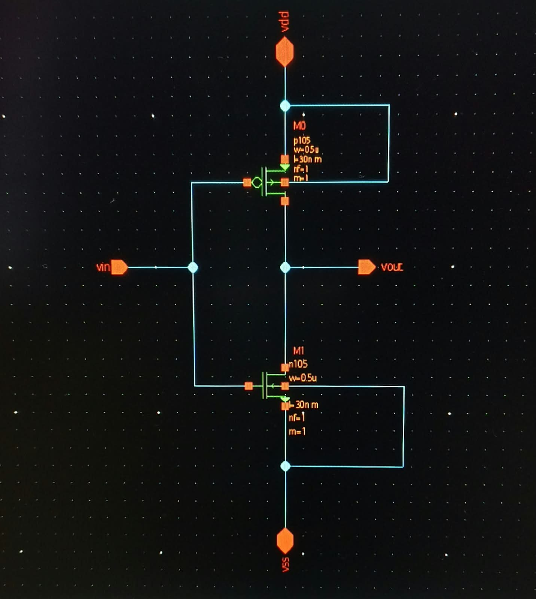
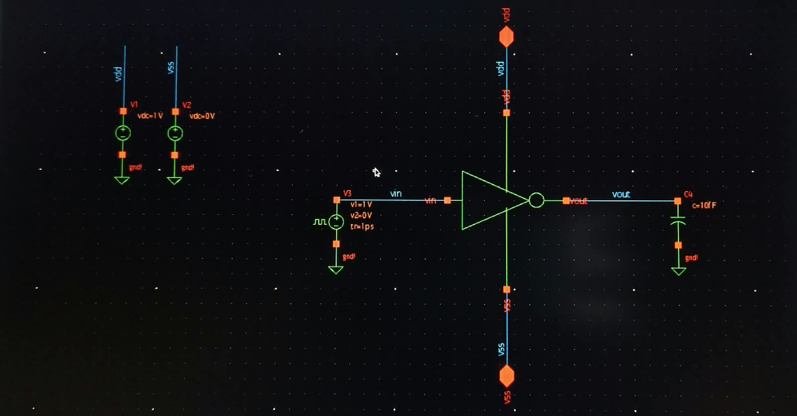
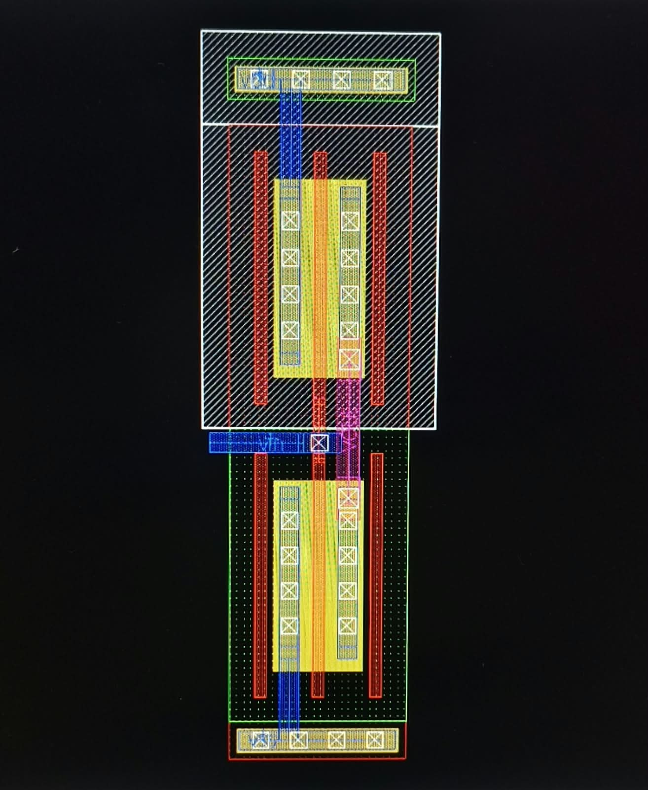
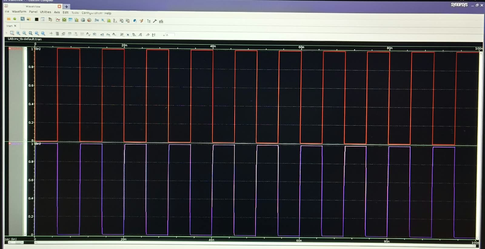
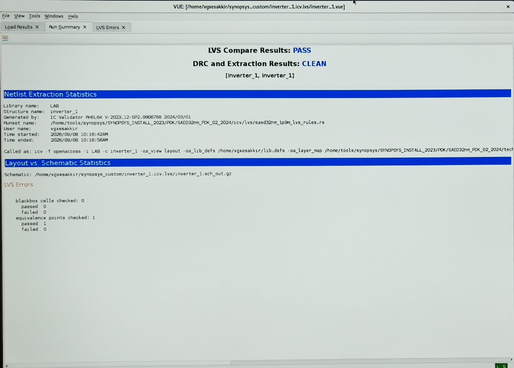

# CMOS Inverter – Custom Layout Design & Verification

A transistor-level **CMOS Inverter** designed and verified using **Synopsys Custom Compiler** with the **SAED 28/32 nm PDK**.

This project covers the complete custom IC design flow from schematic creation to physical layout, symbol generation, simulation, and physical verification.

---

## 📌 Project Overview

A CMOS inverter is a fundamental digital logic cell that produces the complementary output of the input:

| Input (VIN) | Output (VOUT) |
| ----------- | ------------- |
| 0           | 1             |
| 1           | 0             |

The inverter is implemented using one PMOS transistor in the pull-up network and one NMOS transistor in the pull-down network.

### Key Design Parameters

* **Technology:** SAED 28/32 nm PDK
* **Design Tool:** Synopsys Custom Compiler
* **PMOS:** W = 0.5 µm, L = 30 nm
* **NMOS:** W = 0.5 µm, L = 30 nm
* **Number of fingers:** nf = 1
* **Multiplier:** m = 1
* **Supply voltage:** 1 V
* **Output load:** 10 fF

---

## 🔧 Design Flow

The inverter was developed through the following custom layout flow:

```text
Schematic
   ↓
Symbol Creation
   ↓
Layout Design
   ↓
DRC Verification
   ↓
LVS Verification
   ↓
Parasitic Extraction / LPE
   ↓
Post-Layout Simulation
```

---

## 1. Schematic Design

The CMOS inverter schematic consists of:

* PMOS transistor connected between **VDD** and **VOUT**
* NMOS transistor connected between **VOUT** and **VSS**
* Common gate connection to **VIN**
* Common drain connection forming **VOUT**
* PMOS source connected to VDD
* NMOS source connected to VSS



---

## 2. Symbol Creation

A reusable inverter symbol was created from the transistor-level schematic.

The symbol provides:

* **VIN** – Input
* **VOUT** – Output
* **VDD** – Positive supply
* **VSS** – Ground



---

## 3. Custom Layout

The physical layout was created at the transistor level using the SAED technology layers.

The layout includes:

* PMOS active region
* NMOS active region
* Poly gate
* Metal interconnects
* Contacts
* N-well
* Power and ground connections
* Input and output routing

Care was taken to maintain proper connectivity, layer usage, spacing, and design-rule requirements.



---

## 4. Simulation

Transient simulation was performed to verify the logical operation of the inverter.

A pulse input was applied between **0 V and 1 V**, and the output was observed for complementary switching behavior.

### Expected Operation

```text
VIN = 0 V  →  PMOS ON, NMOS OFF  →  VOUT ≈ 1 V

VIN = 1 V  →  PMOS OFF, NMOS ON  →  VOUT ≈ 0 V
```

The simulation waveform confirms that the output is the logical complement of the input.



---

## 5. DRC & LVS Verification

Physical verification was performed after completing the layout.

### Verification Results

* **DRC:** CLEAN
* **LVS:** PASS
* **Extraction:** CLEAN
* **Equivalent Points Checked:** 1
* **LVS Errors:** 0
* **LVS Failed:** 0

The LVS comparison confirms that the extracted layout netlist matches the schematic netlist.



---

## 🧰 Tools & Technologies

| Category              | Details                          |
| --------------------- | -------------------------------- |
| EDA Tool              | Synopsys Custom Compiler         |
| Technology            | SAED 28/32 nm PDK                |
| Design Type           | Custom / Transistor-Level Layout |
| Circuit               | CMOS Inverter                    |
| Simulation            | Transient Analysis               |
| Physical Verification | DRC, LVS                         |
| Extraction            | Parasitic / LPE Extraction       |

---

## 🎯 Key Learning Outcomes

Through this project, I gained practical experience in:

* CMOS inverter transistor-level design
* PMOS and NMOS layout implementation
* CMOS layout layer identification and connectivity
* Power and ground routing
* Contact and metal interconnection
* Design Rule Check (DRC)
* Layout Versus Schematic (LVS)
* Parasitic extraction / LPE
* Transient simulation
* Schematic-to-layout custom IC design flow
* Synopsys Custom Compiler environment

---

## ✅ Final Result

The CMOS inverter successfully completed the custom design flow:

**Schematic → Symbol → Layout → DRC → LVS → Extraction → Simulation**

The layout was verified as **DRC CLEAN** and **LVS PASS**, demonstrating correct physical implementation and schematic-to-layout connectivity.

---

## 📁 Suggested Repository Structure

```text
CMOS-Inverter/
│
├── README.md
├── schematic.jpeg
├── symbol_creation.jpeg
├── layout.jpeg
├── simulation.jpeg
└── verification.jpeg
```

> **Note:** Keep the five image files in the same directory as `README.md` (or update the image paths if you place them inside an `images/` folder).

---

## 👨‍💻 Author

**Esakkiraj G**
B.E. Electronics and Communication Engineering
Custom & Analog Layout Trainee

**Domain:** VLSI | Custom Layout | Analog Layout | CMOS Design
